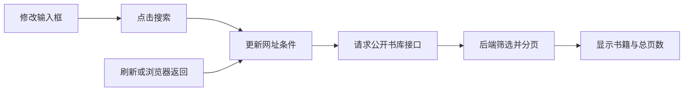

# 从书库搜索理解前端：v0.12 小练习

本次只调整前端，后端接口与数据库结构保持兼容。前端版本为 0.12.0，后端仍为 0.10.0。先打开书库，选一个题材、点击搜索，再刷新页面，可以看到筛选条件仍在。

## 1. 为什么把条件放进网址

例如 `/library?categoryId=1&serialStatus=SERIALIZING&sort=UPDATED&page=2`：`?` 后是查询条件，`page=2` 表示第二页，`/library` 表示独立书库页。网址只记录公开找书条件，不记录账号、密码或令牌。复制网址可以分享同一个查询；作品更新后结果可能变化。

原来条件只放在页面变量里，刷新就重新创建页面，变量恢复默认值。现在以网址为已提交查询的来源，页面创建时读取它，浏览器后退改变网址时也重新读取。

## 2. 输入框与查询结果为什么要分开

你在第二页输入新关键词，但还没有点击“搜索作品”，当前结果仍属于旧条件。如果翻页直接读取输入框，就会突然切到新条件的第三页。

[LibraryPage.vue](../../frontend/src/views/LibraryPage.vue) 用 `form` 保存正在输入的内容，用 `applied` 表示网址中已经提交的条件：

- 搜索：读取 `form`，从第一页开始，并更新网址。
- 翻页：读取 `applied`，只修改页码。未提交的编辑会恢复为当前查询条件。
- 重置：清除所有条件、回到第一页。
- 刷新或浏览器后退：从网址恢复条件。详情页的“返回书库”链接进入默认书库；需要恢复原查询时使用浏览器返回。

## 3. 三个文件各管什么

| 文件 | 负责什么 | 不负责什么 |
| --- | --- | --- |
| [LibraryPage.vue](../../frontend/src/views/LibraryPage.vue) | 表单、页面展示、网址导航、过期尾页回退 | 数据库查询 |
| [libraryQuery.js](../../frontend/src/libraryQuery.js) | 检查和转换参数，拼接网址与接口地址 | 发请求或修改页面 |
| [usePublicLibrary.js](../../frontend/src/composables/usePublicLibrary.js) | 请求、加载状态、错误、重试、取消旧请求 | 输入框内容、登录身份判断 |

`normalizeLibraryQuery()` 将外部输入变成可用条件：关键词最多 100 个字符，页码为 1—100000 的整数，排序只能使用四种已有值。重复参数或非法值回退为默认值；后端仍独立检查参数，不能只信任前端。



## 4. 为什么需要取消请求

先搜索“山”，再搜索“海”，第一条请求可能更慢。如果它最后才返回，页面就可能错误地显示“山”。

`usePublicLibrary()` 在条件改变或页面销毁时调用 `AbortController.abort()`，并把旧请求标记为失效。即使旧响应仍然返回，也不会写入结果、错误或加载状态。每次加载清空旧书籍，避免用户把旧列表当成新结果点击；失败时保留网址条件，可点击“重试查询”。

题材列表与书库分开加载，所以题材接口失败时仍然可以搜索。旧网址指向已经不存在的尾页时，页面依据服务器返回的总数回到最后一页，不制造虚假的数据。

## 5. 什么是按需加载

[router.js](../../frontend/src/router.js) 原来在启动时导入所有页面；现在保留首页，其他页面采用以下形式：

```js
const ChapterEditorPage = () => import('./views/ChapterEditorPage.vue')
```

可以理解为先打开当前需要的章节，再去取其他章节。访问首页时不必同时下载作者编辑器和管理员页面。Vue Router 在进入对应页面时加载，浏览器之后可以缓存资源；原有登录和角色守卫仍然执行，后端权限检查也仍然需要。

v0.11 的这一改动减少首页必需的代码，而整个系统仍保留原来的功能。测试中，入口和静态依赖合计 JavaScript 从 325,328 字节变成 220,279 字节；全部分包合计稍有增加，因此不能说“整个项目体积减少了 32%”。测量口径见 [v0.11 验证记录](../验证记录_v0.11.md)。这是历史版本的测量，不是 v0.12 的体积对比。

## 6. 自己操作一遍

1. 在书库选择题材和排序，点击搜索，观察网址。
2. 翻到第二页，刷新，看条件与页码是否保留。
3. 进入一本小说，再用浏览器返回，看是否恢复原查询。
4. 修改关键词但不点击搜索，直接翻页，确认仍使用原查询。
5. 对照上述三个文件，分别找出输入、请求、结果显示的位置。

能解释这五步，就已经理解了这次改动的核心，不必一次背完全部 Vue 语法。
