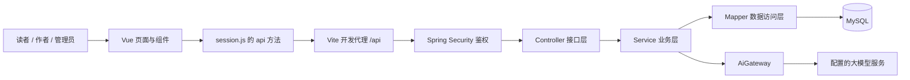
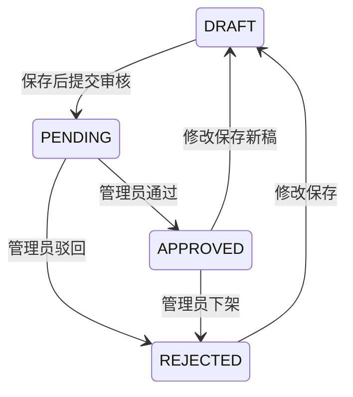

# 原创小说读写平台：项目构成与代码解析

基线：v0.13（前后端 0.13.0）。本文解释当前真实实现，不把课程设计中的规划或开源参考工程功能当作已经完成。运行方式见[工程说明](../../README.md)，书架升级见[v0.10 验证记录](../验证记录_v0.10.md)，最新前端改动见[书库查询与按需加载](书库查询与按需加载.md)与[v0.12 界面设计](../界面与交互设计_v0.12.md)及[验证记录](../验证记录_v0.12.md)。

## 1. 先看整体：这是一个怎样的项目

系统采用前后端分离：Vue 页面负责展示和收集操作，Spring Boot 接口负责鉴权与业务规则，MySQL 保存数据。后端为单体应用，按业务包划分；前端使用 JavaScript、Vue Composition API 与 Element Plus。当前没有拆微服务，没有使用 Redis、消息队列、Pinia 或 Vuex。



开发时页面端口为 5173、后端为 8081、独立 MySQL 为 13406。Vite 代理仅是开发配置，`npm run build` 生成静态文件并不会自动部署后端和数据库。生产发布还需要静态站点服务、接口代理、HTTPS 和运行环境配置。

## 2. 目录各自负责什么

下面相对于正式工程根目录，省略生成文件和依赖。

```text
02_项目源码/
├─ backend/
│  ├─ pom.xml                         Java 依赖、版本和构建
│  └─ src/
│     ├─ main/java/com/novelplatform/
│     │  ├─ NovelPlatformApplication.java
│     │  ├─ auth/                     登录、JWT、安全配置、管理员初始化
│     │  ├─ user/                     账号实体、Mapper、安全返回视图
│     │  ├─ content/                  小说、章节、审核、公开阅读
│     │  ├─ reading/                  书架、阅读进度及书架筛选
│     │  ├─ comment/                  评论、回复、点赞与管理删除
│     │  ├─ discovery/                书库检索、榜单、推荐、统计
│     │  ├─ writing/                  总纲、人设、章目标与上下文预览
│     │  ├─ ai/                       AI 校验、限流和外部请求
│     │  ├─ admin/                    用户维护、分类标签和操作记录
│     │  └─ common/                   业务异常与错误响应
│     ├─ main/resources/
│     │  ├─ application.yml           从环境变量读取运行配置
│     │  └─ db/migration/             V1—V7 数据库迁移
│     └─ test/                        H2 集成测试及单元测试
├─ frontend/
│  ├─ package.json / package-lock.json
│  ├─ vite.config.js                 Vue 构建、开发端口与 API 代理
│  ├─ src/
│  │  ├─ main.js / App.vue           挂载入口、公共页头和布局
│  │  ├─ router.js / navigation.js   路由与登录去向
│  │  ├─ session.js                 登录状态与统一请求
│  │  ├─ views/                     完整业务页面
│  │  ├─ components/                评论、分页、封面、AI、账号菜单和工作区布局
│  │  ├─ composables/               公开书库请求与共享阅读偏好
│  │  └─ *.js / *.css               草稿等辅助逻辑及样式
│  └─ tests/                        Node 测试
├─ database/                        数据结构、演示和参考数据说明
├─ scripts/                         构建、启动及可选数据导入脚本
└─ docs/                            设计、验证和本代码解析
```

`.runtime/` 是本机数据库、运行配置和日志；`target/`、`dist/`、`node_modules/` 是生成物或依赖。它们不应作为源码上传。课程 Word、教师模板、私人项目管理与开源实验目录也不属于公开业务工程。

## 3. 13 个模块与源码如何对应

后端文件位置均在 `backend/src/main/java/com/novelplatform/`，页面位于 `frontend/src/views/`。多个功能共用一个 Service 是当前规模下的组织方式，不要求一个模块必须拆成独立应用。

| 模块 | 前端入口 | 主要后端实现 | 重点看什么 |
| --- | --- | --- | --- |
| 1 注册登录、资料 | AuthPage、ProfilePage | auth/AuthController、AuthService、SecurityConfig | 注册角色限制、密码散列、JWT 失效 |
| 2 浏览检索 | HomePage、LibraryPage、RankingsPage | content/ContentController、discovery/DiscoveryService | 公开书名、组合筛选和榜单规则 |
| 3 在线阅读 | ReadingPage、SettingsPage、ReadingPreferences 组件 | content/ContentService、reading/ReadingService | 分章正文、段落进度、正文指纹 |
| 4 书架收藏 | BookshelfPage、BookReadingActions 组件 | reading/ReadingController、ReadingMapper | 幂等收藏、本人隔离、全量筛选后分页 |
| 5 评论互动 | CommentSection、CommentItem 组件 | comment/CommentController、CommentService | 根评论与回复、点赞唯一性 |
| 6 作品发布 | AuthorPage、NovelEditorPage | content/ContentService | 作者归属、保存与送审分离 |
| 7 章节编辑 | ChapterEditorPage | content/ContentService、ChapterMapper | 序号、版本冲突、软删除、本地草稿 |
| 8 AI 辅助创作 | WritingStudioPage、AiAssistant、AiContextPanel | writing/WritingContext、WritingAiService、ai/AiGateway | 资料归属、前文顺序、指纹、候选采用 |
| 9 作品数据 | AuthorStatsPage、AuthorStatistics 组件 | discovery/DiscoveryService、DiscoveryMapper | 真实去重阅读、收藏、七日趋势 |
| 10 用户信息管理 | AdminUsersPage | admin/AdminService | 启停账号、管理版本、旧令牌失效 |
| 11 作品审核 | AdminReviewPage | content/ContentService | 分别审核作品和章节、公开快照 |
| 12 评论管理 | AdminCommentsPage | comment/CommentService | 管理删除原因及审计字段 |
| 13 分类标签 | AdminTaxonomyPage | admin/AdminService、AdminMapper | 分类引用、标签关联和删除保护 |

AdminAuditsPage 提供账号、分类标签和作品归类记录的检索。内容审核与评论处理有各自记录，不应说所有业务日志已合并到这一页。

## 4. 从点击按钮到 SQL：一条请求的全过程

以本轮“书架内搜索”为例，按下面的文件顺序阅读即可跟踪完整链路：

1. [BookshelfPage.vue](../../frontend/src/views/BookshelfPage.vue) 使用 `filters` 保存输入，`search()` 将条件复制到 `applied`，再执行 `load(1)`。输入框变化不会悄悄改变正在翻页的查询条件。
2. `load()` 用 `URLSearchParams` 构造 `/me/bookshelf?keyword=…&status=READ&sort=RECENT_READ&page=1&size=12`。
3. [session.js](../../frontend/src/session.js) 的 `api()` 补上 `/api`、JSON 请求头和 `Authorization: Bearer …`；默认不发送 Cookie。网络失败转成可读提示，401 清除本地登录状态。
4. [vite.config.js](../../frontend/vite.config.js) 将开发页面的 `/api` 请求代理到后端。浏览器看到的同源路径不意味着业务在前端执行。
5. [SecurityConfig.java](../../backend/src/main/java/com/novelplatform/auth/SecurityConfig.java) 验证 JWT 和账号状态。未登录不能访问 `/api/me/**`。
6. [ReadingController.java](../../backend/src/main/java/com/novelplatform/reading/ReadingController.java) 从 `Authentication` 取账号 ID，读取分页和筛选参数，调用 `ReadingService.shelf()`。客户端不能指定另一个账号来查看书架。
7. [ReadingService.java](../../backend/src/main/java/com/novelplatform/reading/ReadingService.java) 检查参数白名单，在只读事务里调用 Mapper，构造 `ShelfItem` 和阅读恢复信息。
8. [ReadingMapper.java](../../backend/src/main/java/com/novelplatform/reading/ReadingMapper.java) 连接书架、小说及当前账号进度，先筛选再 `LIMIT/OFFSET`，总数也使用相同条件。
9. Controller 返回 `ContentViews.Page` 对象，Spring 转成 JSON；Vue 给 `result.value` 赋值，列表和分页组件自动更新。

该接口的响应结构是 `{items, page, size, total}`，并没有额外包一层通用 `code=200`。发生业务错误时则返回对应 HTTP 状态和 `{code, message}`，由 [ApiExceptionHandler.java](../../backend/src/main/java/com/novelplatform/common/ApiExceptionHandler.java) 处理。

Mapper 中 `#{keyword}` 是绑定参数，不是直接拼接 SQL。`LOCATE` 按字面子串查询，因此 `%`、`_` 不会变成任意匹配。搜索使用 `n.public_title`，不会暴露作者的新草稿标题；已收藏的下架作品保留书架条目，但 `resolve()` 不返回可阅读入口。

“已读”指存在 `reading_progress`，不是阅读完成率。`RECENT_READ` 使用进度更新时间倒序，未读位于后面，再按收藏时间与作品编号稳定排序。列表每次最多 50 项；返回每项恢复信息仍会额外访问数据库，这是当前实现可进一步做批量查询优化的位置。

## 5. 登录和权限：为什么前后端都要判断

[AuthService.java](../../backend/src/main/java/com/novelplatform/auth/AuthService.java) 注册时把账号规范成小写，使用 `PasswordEncoder` 保存密码散列；当前具体算法为 `Pbkdf2PasswordEncoder`，不是 BCrypt。登录通过 `matches()` 比较密码，失败统一提示，成功由 [TokenService.java](../../backend/src/main/java/com/novelplatform/auth/TokenService.java) 签发有效期两小时的 HS256 JWT。

JWT 主要包含签发方、用户 ID、签发/过期时间和令牌版本 `ver`。每次请求不仅验证签名，还查询数据库中的 `enabled`、`token_version` 和实际角色。因此管理员停用账号或用户退出后，旧令牌可以立即失效；退出递增账号令牌版本，也会使同账号其他登录令牌失效。当前没有刷新令牌和“记住我”的长期会话。

[router.js](../../frontend/src/router.js) 的 `beforeEach` 负责页面入口：需要登录时转向登录页，角色不符时转到相应首页，刷新时使用 `/users/me` 恢复用户信息。[navigation.js](../../frontend/src/navigation.js) 对登录返回地址使用白名单。前端守卫改善导航体验，真正的安全边界仍在后端。

| 路径类别 | 服务端规则 |
| --- | --- |
| `/api/public/**` 的 GET | 游客可读，但业务层继续检查是否公开和下架 |
| `/api/auth/register`、`/api/auth/login` | 允许公开 POST，注册只允许读者或作者 |
| `/api/author/**` | AUTHOR，之后仍核对作品归属 |
| `/api/admin/**` | ADMIN |
| 其他 `/api/**` | 已认证，例如书架与个人资料 |

角色判断与数据归属不同：作者 A 和作者 B 都通过 AUTHOR 检查，但 A 不能修改 B 的章节。`ContentService.owns()` 才负责这个限制。管理员不是自动继承作者身份；其审核功能使用独立管理接口。

## 6. 作品和章节：保存为什么不等于发布

重点阅读 [ContentService.java](../../backend/src/main/java/com/novelplatform/content/ContentService.java) 的 `updateNovel()`、`updateChapter()`、`submitNovel()`、`submitChapter()`、`reviewNovel()`、`reviewChapter()`。



状态图描述审核状态，是否可读还要同时看 `published`、`takenDown`，章节还要检查 `deleted` 和父作品。因此不能只凭 `reviewStatus=APPROVED` 判断公开性。

`novel` 的 `title/introduction` 与 `chapter` 的 `title/content` 是作者当前草稿；`public_title/public_content` 等字段是通过审核的快照。首次草稿没有公开版本；已公开作品修改成 DRAFT 时，旧公开快照继续可读。下架则通过 `takenDown` 阻断访问。

`reviewChapter()` 中真正发布的是类似下面的赋值，省略了校验及其他字段：

```java
c.setPublicTitle(c.getTitle());
c.setPublicContent(c.getContent());
c.setPublicChapterNumber(c.getChapterNumber());
c.setPublished(true);
c.setTakenDown(false);
```

方法有 `@Transactional`，审核记录与快照更新一起提交；不是先改状态再异步发布正文。作品与章节分别审核，作品通过不代表全部章节自动通过。

`version(actual, expected)` 检查前端带来的版本号，旧版本返回 409，防止两页互相覆盖。更新不是仅靠前端禁用按钮，也不是简单宣称 MyBatis-Plus 自动乐观锁：实现使用显式版本比较与 `FOR UPDATE` 行锁。章节写入先锁父作品，再锁章节，统一锁顺序减少并发交错。

章节删除是软删除，序号置空以释放位置；历史编号及审核关联保留。新章序号建议取未删除章节的最大值加一，不预占位置，最终保存仍校验序号唯一性。

## 7. 书架、阅读进度和本地草稿是三种数据

| 数据 | 保存位置 | 为什么分开 |
| --- | --- | --- |
| 收藏书架 | MySQL `bookshelf` | 决定“我的书架”有哪些作品 |
| 阅读进度 | MySQL `reading_progress` | 移出书架后仍记得上次章节和段落 |
| 作者未保存的草稿备份 | 浏览器 localStorage | 刷新后恢复尚未提交服务器的文字 |
| 字号、背景、行距、阅读宽度 | 浏览器 localStorage | 当前浏览器的阅读偏好，不是跨设备账号设置 |

[ReadingPage.vue](../../frontend/src/views/ReadingPage.vue) 将正文按空行分段，滚动时根据段落位置估算当前段落，约 800ms 防抖保存。服务端进度包含章节 ID、段落索引、正文指纹和版本号。`ReadingText.revision()` 生成 SHA-256 指纹；正文修订导致指纹不同，就不能用旧坐标假装准确恢复。

`ReadingService.save()` 检查作品可见、章节归属和可读性、段落范围、正文指纹及版本。另一页面先保存后，旧版本得到 `PROGRESS_CONFLICT`；前端暂停自动覆盖并提供用户确认后的重试。收藏和保存进度通过锁定账号行处理同一用户首次插入的竞争。

[useChapterDraft.js](../../frontend/src/useChapterDraft.js) 与 [chapterDraft.js](../../frontend/src/chapterDraft.js) 是作者编辑备份。缓存键按账号与章节隔离，新章按作品隔离，保留七天并在该页面打开时清理过期项。约 600ms 备份一次；恢复前要确认，版本变更时提醒核对。保存服务器成功后清除本页对应缓存。

缓存比较可以发现另一标签已修改的记录，但不是数据库级原子事务。存储空间不足、清理浏览器数据或关闭太快仍可能丢失未保存内容。AI 尚未采用的预览不属于正文缓存。TXT 导出使用 Blob 和下载链接；文本生成已通过自动检查，下载落盘于 2026-10-26 获用户验收确认，属于人工确认结果。

## 8. 评论、榜单与作者数据怎样计算

[CommentService.java](../../backend/src/main/java/com/novelplatform/comment/CommentService.java) 的 `create()` 对小说或章节评论进行范围校验。回复用 `rootId` 指向所属根评论，`replyToId` 指向具体回复对象，因此页面可以在一个讨论串内展示“回复某人”。

点赞表以评论和账号联合主键保证同账号不能重复点赞；`like()` 在事务和锁保护下实现重复操作不多加一。删除保留占位和审计字段，根评论下其他回复仍可查看。用户只能删自己的评论，管理员删除需要原因。评论和点赞写事务使用 READ_COMMITTED，避免等待锁后继续读取旧快照造成错误冲突。

[DiscoveryService.java](../../backend/src/main/java/com/novelplatform/discovery/DiscoveryService.java) 与 [DiscoveryMapper.java](../../backend/src/main/java/com/novelplatform/discovery/DiscoveryMapper.java) 负责四类榜单、书库排序、同类推荐和统计。首页书库的 GET `/public/novels` 实际已委托给 DiscoveryService；ContentService 中仍有早期 `publicBooks()` 实现，不能只因方法存在就把它描述成当前调用入口。

| 指标或榜单 | 当前口径 |
| --- | --- |
| 阅读 | 正文成功展示后上报；同身份、同作品、同自然日去重 |
| 本周热门 | 当天及前六天的阅读，再用收藏和编号处理并列 |
| 收藏榜 | 当前书架收藏数，移出后减少 |
| 新书榜 | 首次审核公开时间 |
| 更新榜 | 章节最近审核通过时间 |
| 作者七日趋势 | 本人作品的每日去重阅读，缺失日期补零 |

自然日按 Asia/Shanghai，存储事件时间为 UTC。游客 UUID 和账号身份经带用途前缀的 HMAC 派生用于统计，游客清除会话后会形成新身份，因此不能把阅读量说成“绝对真实独立人数”。不补造历史阅读量，作者统计也不返回其他作者的私有数据。

## 9. 创作资料如何进入 AI

先在 [WritingStudioPage](../../frontend/src/views/WritingStudioPage.vue) 维护总纲和角色。两个表单组件各自管理未保存状态，页面协调切换和离开提示；[WritingService](../../backend/src/main/java/com/novelplatform/writing/WritingService.java) 校验作品归属和资料版本。

章节页拥有正文和本章目标，保存时由 ContentService 在同一事务写入正文与 writing_chapter_note。本地备份也包含目标。新章尚无 ID 时同样可以起草候选，但只有点击“保存草稿”才创建服务器章节。

1. [AiAssistant](../../frontend/src/components/AiAssistant.vue) 根据起草、续写、润色或扩写准备素材快照。
2. [AiContextPanel](../../frontend/src/components/AiContextPanel.vue) 读取角色和较早章节，作者勾选后请求引用预览。
3. [WritingContext](../../backend/src/main/java/com/novelplatform/writing/WritingContext.java) 再次校验归属、顺序和上限，把总纲、人设、前文、目标及当前素材组成结构化资料，并计算指纹。
4. 作者核对具体内容，点击确认后，[WritingAiService](../../backend/src/main/java/com/novelplatform/writing/WritingAiService.java) 重建资料并核对指纹，再调用 AiGateway。
5. 返回后重查指纹；资料过期时拒绝候选。生成不占数据库事务，不自动写正文。
6. 前端允许修改候选，再由 [aiDraft.js](../../frontend/src/aiDraft.js) 检查原稿未变后填入、追加或替换；最近一次采用仍可撤销。

章目标、正文、章节号和要求改变后清除旧引用预览。引用只读当前书较早的已保存草稿，最多两章、每章末尾 2000 字符；不保证拥有整本长篇记忆。输入 JSON 上限 32000 字符不是 token 数。摘要、关系图与 AI 生成大纲、人设尚未实现。

旧章节级接口保留兼容，仍只接受 CONTINUE/POLISH。新界面使用 DRAFT/CONTINUE/POLISH/EXPAND。AiLimiter、超时、密钥后端读取、错误脱敏继续复用。本轮生成保护使用隔离模拟验证，没有额外调用 DeepSeek；旧两次真实联调不证明本次新提示词质量。详细接口与边界见 [创作设计](../创作工作台设计与接口.md)和 [v0.13 验证记录](../验证记录_v0.13.md)。

## 10. 数据库为什么是 16 张业务表

唯一建表来源为 [Flyway 迁移目录](../../backend/src/main/resources/db/migration/)。迁移成功记录在 `flyway_schema_history`，该表是工具管理表，不计入业务表数量。已经执行的迁移不应修改来绕过校验；新增结构使用下一版迁移。v0.13 的 V7 新增三张作者私有表。

| 迁移 | 业务表 | 主要关系或约束 |
| --- | --- | --- |
| V1 | app_user | 用户名唯一；角色、启用和令牌版本 |
| V2 | novel_category | 小说题材 |
| V2 | novel | 作者、分类、草稿与公开字段 |
| V2 | chapter | 所属小说、草稿/公开序号和正文 |
| V2 | content_review | 小说或章节的审核与内容快照 |
| V3 | bookshelf | 用户与小说联合主键 |
| V3 | reading_progress | 用户与小说联合主键，指向上次章节 |
| V4 | reader_comment | 用户、作品、可选章节、回复关系 |
| V4 | comment_like | 评论与用户联合主键 |
| V5 | novel_read_day | 访问身份、作品、自然日去重 |
| V6 | novel_tag | 标签名称唯一 |
| V6 | novel_tag_link | 小说与标签联合主键 |
| V6 | admin_audit | 管理员编号、目标、动作、原因与时间 |
| V7 | writing_project | 作品总纲、世界规则与文风 |
| V7 | writing_character | 角色卡、作品内姓名唯一与版本 |
| V7 | writing_chapter_note | 稳定章节 ID 对应本章目标 |

MyBatis-Plus 的 `BaseMapper` 用于常规实体查询和更新；复杂聚合、分页和加锁由 Mapper 的注解 SQL 实现，当前没有为每个 Mapper 再创建 XML。领域实体表示数据库内容，`ContentViews`、`UserView`、`AdminModels` 等返回视图控制接口字段；特别是公开接口不能直接序列化含草稿的完整实体。

用户停用保留作品和评论；使用中的分类、标签不能直接删除。管理员调整已公开作品归类时只同步分类标签，不顺带发布作者草稿正文。维护操作写入 `admin_audit`，v0.9 增加分页检索，旧最近 50 条接口仍保留兼容。

## 11. 如何运行和验证自己理解的逻辑

在正式工程目录使用 PowerShell，工具版本以 [README](../../README.md) 为准：

```powershell
.\scripts\dev.ps1 -Action Stop
.\scripts\build.ps1
.\scripts\dev.ps1 -Action Start
.\scripts\dev.ps1 -Action Status
```

先停止服务再完整构建，避免 Windows 占用正在使用的 jar 或依赖。脚本只处理自身记录并核对身份的进程；不清空数据库。管理员初始化配置从本机私有文件读取，不在本资料提供账号和密码。

| 验证层 | 实际检查内容 | 不能据此声称 |
| --- | --- | --- |
| 后端 `mvn test` | H2 隔离数据库中的规则、权限、冲突和异常 | MySQL 特性与生产环境全部通过 |
| 前端 `node --test` | 导航、草稿保护、分页等纯逻辑 | 所有页面视觉和点击正常 |
| Vite build | 前端模块能够生成生产静态产物 | 网络请求、鉴权或真实 AI 一定成功 |
| 本地 MySQL HTTP 检查 | 当前数据库上的实际接口行为 | 压力、渗透和公网部署已验收 |
| Tabbit 页面操作 | 指定交互、尺寸与实际页面表现 | 所有浏览器和缩放比例均已覆盖 |

具体结果以各版本验证记录为准，测试失败应保留记录并说明修复后结果。不要把演示小说的合成数据或参考导入量写成真实用户运营数据。

## 12. 修改功能时应该改哪里

如果老师让你“给书架增加一个条件”，先明确它对应哪个数据库字段以及是否影响权限，再按页面输入 → Controller 参数 → Service 白名单 → Mapper 的列表与总数条件 → 测试的顺序改。只在前端筛掉当前页会让总数和翻页错误。

如果让你“修改登录后的去向”，优先看 `navigation.js` 与 `router.js`；如果让你“防止作者修改别人作品”，应看 SecurityConfig 和 ContentService 的归属校验。两类问题不能互相替代。

如果让你“增加小说字段”，检查数据库迁移、实体、请求参数、草稿保存、审核快照、公开返回视图和页面展示；只改一个表单不会自动完成发布流程。

排错时先看浏览器网络状态：401 表示登录失效，403 表示角色权限不足，404 可能是不存在或无权查看，409 通常是版本、审核状态或引用冲突。500 则查本机后端日志与复现步骤，不把含私人配置的日志上传公开仓库。

## 13. 答辩时可以准确讲出的设计取舍

- **审核前后分离**：草稿与公开快照分开保存，使作者修订不影响读者阅读已审核内容；代价是实体包含两组字段。
- **权限分两层**：路径鉴权决定角色能否进入功能，业务归属决定是否能操作这一条数据。
- **并发保护**：服务端版本比较配合行锁保护写入，前端保留输入并显示冲突，不能靠按钮禁用保证一致性。
- **阅读恢复**：以章节与段落恢复而非绝对滚动像素，正文指纹变化后从章首恢复，避免错位。
- **AI 保持人工控制**：生成与保存、审核分离，先预览再采用；外部调用失败不会写坏服务器稿件。
- **真实性边界**：真实模型小样本调用已通过；完整压力与安全测试、生产部署仍未完成；标签搜索、作者提报标签、密码重置也不是当前已交付功能。

建议演示时选自己创建的测试作品，走“保存草稿 → 提交审核 → 管理员通过 → 读者收藏阅读 → 书架按已读筛选”这一条完整链路，再对照上面的源码解释每一步。理解每个判断为什么存在，比背诵框架名更有说服力。
