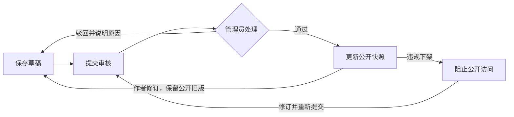

# 作品、章节、审核与阅读 · v0.2

本轮围绕“作者写作 → 提交审核 → 管理员处理 → 读者阅读”实现，保留账号模块。以下是当前实现的工作基线，后续业务调整应同步修改接口、数据迁移与验证记录。

## 关键规则

1. 注册角色为读者或作者；作者拥有公开阅读能力，只能维护自己的作品、章节与审核摘要。管理员才能审核、下架。角色由后端从账号读取，不能通过提交字段提权。
2. 连载/完结是创作状态；草稿/待审核/通过/驳回是审核状态；是否下架独立保存。作品与章节各自审核，作品通过不自动公开其草稿章节。
3. 保存草稿与提交审核是两个动作。简介、正文可以暂存为空，但提交前必须补齐；待审核期间禁止修改、删除和重复提交。
4. 首次通过时生成公开快照。已发布内容被修改后，读者继续读取上次通过的标题、简介、题材、连载状态、章节序号和正文；新稿通过才整体替换对应快照。新稿被驳回不会自动移除旧版。
5. 小说下架后，详情、目录和所属章节直链都返回不可访问；单章下架只隐藏该章。重新提交并通过后才恢复。下架使待审核版本失效，过期的审核操作返回冲突。
6. 每次写入携带 `version`。后端在事务中加行锁并检查版本，防止覆盖他人的最新保存和重复审核；不依赖前端按钮禁用。所有章节写操作先锁父作品，再锁章节，保证章节序号与作品下架的写入顺序一致。
7. 同一作品的草稿章节序号不能重复，公开序号也不能重复。批准修订时若公开位置仍被占用，返回 409，事务回滚；管理员可驳回让作者调整。章节软删除保留 ID 与审核关系，释放序号，不提供撤销删除入口。
8. 公开列表按作品 ID 倒序排列，不代表热门榜单。书名与作者昵称按关键词搜索，可组合题材；`%`、`_` 按普通字符处理。章节按公开序号排序，上一章/下一章自动跳过未公开、下架、已删除内容。



答辩时可用一个例子解释：第一章原文已通过，作者把结尾改成另一段。保存只改变草稿，读者仍看到原文；管理员通过修订后才看到新结尾。`public_*` 字段实现这一隔离，`content_review` 记录审核前的内容及版本，事务保证记录与处理结果同时成功或同时失败。

## 数据与页面

V2 迁移新增四张表，保留 V1 账号表。`novel_category` 初始化六种题材，`novel` 关联作者与题材，`chapter` 关联作品，`content_review` 关联作品、可选章节与处理人。完整字段与索引见 [V2 迁移](../backend/src/main/resources/db/migration/V2__novels_chapters_review.sql)。

| 页面 | 路由 | 用途 |
| --- | --- | --- |
| 首页书库 | `/` | 真实作品列表、关键词与题材检索、分页 |
| 作品详情 | `/books/:id` | 公开简介与分页目录 |
| 阅读 | `/read/:id` | 正文、章节切换、字号 16—28 px、浅色/护眼/深色 |
| 作者工作台 | `/author` | 本人作品列表 |
| 作品编辑 | `/author/novels/new`、`/author/novels/:id` | 草稿、连载状态、送审、章节入口与审核摘要 |
| 章节编辑 | `/author/novels/:novelId/chapters/new`、`/author/chapters/:id` | 新增、保存、修改、删除、送审 |
| 审核中心 | `/admin` | 待审/已有公开版本/全部，正文审阅、通过、驳回、下架 |

阅读设置使用浏览器 localStorage，正文以纯文本渲染。未保存编辑离开时确认；保存或审核失败时显示具体原因，输入不自动清空。当前没有自动保存草稿和账号阅读进度同步。

## 接口约定

所有路径以 `/api` 开头；受保护接口使用 `Authorization: Bearer <token>`，登录接口沿用[账号模块说明](账号模块设计与接口.md)。返回 JSON；创建成功 201，删除成功 204，参数错误 400，未登录 401，角色不符 403，不存在/他人私有内容/不可公开内容 404，版本或状态冲突 409。

分页结果为 `{items, page, size, total}`，页码从 1 开始，上限 100000；每页 1—50 条。不同接口默认 12 或 20 条。章节列表不返回整章正文，需读取详情。审核摘要按最近顺序最多 50 条。

| 方法与路径 | 权限 | 内容 |
| --- | --- | --- |
| GET `/public/categories` | 游客 | 六种题材 |
| GET `/public/novels` | 游客 | `keyword`（最多 100 字）、`categoryId`、`page`、`size` |
| GET `/public/novels/{id}` | 游客 | 公开作品详情 |
| GET `/public/novels/{id}/chapters` | 游客 | 公开目录，`page`、`size` |
| GET `/public/chapters/{id}` | 游客 | 公开正文与 `previousChapterId`、`nextChapterId`；没有相邻章时为 null |
| GET / POST `/author/novels` | 作者 | 本人作品分页 / 新建作品 |
| GET / PUT `/author/novels/{id}` | 所属作者 | 读取 / 保存作品草稿 |
| POST `/author/novels/{id}/submit` | 所属作者 | 提交作品审核 |
| GET / POST `/author/novels/{id}/chapters` | 所属作者 | 本人章节分页 / 新建章节 |
| GET / PUT `/author/chapters/{id}` | 所属作者 | 读取 / 保存章节草稿 |
| POST `/author/chapters/{id}/submit` | 所属作者 | 提交章节审核 |
| DELETE `/author/chapters/{id}?version=…` | 所属作者 | 软删除章节 |
| GET `/author/novels/{id}/reviews` | 所属作者 | 审核摘要，不包含完整快照或处理人身份 |
| GET `/admin/novels`、`/admin/chapters` | 管理员 | `state=PENDING/PUBLISHED/ALL` 和分页；PUBLISHED 包括已下架但有公开版本的内容 |
| GET `/admin/novels/{id}`、`/admin/chapters/{id}` | 管理员 | 读取最新完整草稿及公开快照 |
| POST `/admin/novels/{id}/review`、`/admin/chapters/{id}/review` | 管理员 | 审核决定 |
| POST `/admin/novels/{id}/takedown`、`/admin/chapters/{id}/takedown` | 管理员 | 下架及原因 |
| GET `/admin/novels/{id}/reviews` | 管理员 | 所属作品最近审核摘要 |

作品创建/保存体：

```json
{"title":"示例作品","introduction":"作品简介","categoryId":1,"serialStatus":"SERIALIZING","version":0}
```

标题 1—50 字，简介最多 1000 字；连载状态为 SERIALIZING 或 COMPLETED。新建时 version 必须为 0；保存时必须取最新详情返回值。

章节创建/保存体：

```json
{"chapterNumber":1,"title":"第一章","content":"章节正文","version":0}
```

章节序号为 1—100000，标题 1—100 字，正文最多 20000 字。创建时 version 为 0，提交审核体为 `{"version":最新版本号}`。

审核体包含 `version`、`action`（APPROVE 或 REJECT）、`reason`；reason 为字符串，最多 500 字，驳回时非空。下架体包含 `version`、非空 `reason`。不能用前一次保存的版本直接执行后续操作，应使用每次响应返回的新版本。

## 验证与下一步

运行方式、人工验收路径见[工程 README](../README.md)，已执行的检查见[v0.2 验证记录](验证记录_v0.2.md)。现阶段未实现书架、账号进度、评论、榜单、统计、AI 及后台用户/分类标签/评论维护；固定题材不是分类管理模块完成的证明。

下一轮优先完成书架与账号阅读进度：服务端校验数据归属，书架快速阅读复用公开目录规则；遇到被下架或删除章节时不能恢复到不可访问内容。
