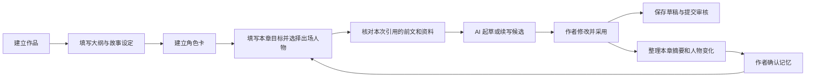

# 作者创作工作台升级方案

日期：2026-10-29。本文为最初升级提案。首批已在 v0.13 实现，另穿插本地取名和选段扩写，见 [当前设计与接口](创作工作台设计与接口.md)；下文分批列表包含尚未实现的后续功能。用户已选择“作者主导：填写设定和本章目标，AI 按前文辅助写，逐次确认采用”。本文细化 FR-06/07/08，不替代当前功能说明，也不把计划功能写为已完成。

## 1. 当前功能为什么不够好用

已经检查实际源码，而非只看按钮名称：

| 实际位置 | 当前行为 | 使用上的后果 |
| --- | --- | --- |
| [ChapterEditorPage.vue](../frontend/src/views/ChapterEditorPage.vue) | 保存出章节 ID 后才展示 AI 面板 | 新章入口先要求保存，作者不知道从何开始 |
| [aiDraft.js](../frontend/src/aiDraft.js) | 续写只取当前编辑区末尾最多 6000 字符，空白拒绝处理 | 上一章写完，新建空白章无法直接接着起草 |
| [AiService.java](../backend/src/main/java/com/novelplatform/ai/AiService.java) | 检查章节归属与版本后，只传当前素材和要求给网关 | 没有读取本书其他章节、大纲和角色设定 |
| [AiGateway.java](../backend/src/main/java/com/novelplatform/ai/AiGateway.java) | 只区分续写、润色，续写提示约 300—600 字 | 缺少章节起草、剧情推演和设定辅助等任务 |

现有预览、编辑、采用、撤销和过期保护值得保留。空正文目前可以保存草稿，但不能送审；限制空白素材的是 AI 准备流程，不能把它误写成数据库不允许空草稿。

## 2. GitHub 调研与取舍

本次阅读公开项目说明、目录及本工程源码，没有下载运行这些写作软件，也没有对输出质量做横向测试。下列是可借鉴的流程，不能据此断言某个模型或项目的成稿质量更好。

| 项目 | 项目说明呈现的做法 | 本工程拟采用的部分 |
| --- | --- | --- |
| [Pagekin / AI-Novel-Writer](https://github.com/EthanYoQ/AI-Novel-Writer) | 将作品设定、章节安排和正文处理串联；生成时组织章节相关资料 | 把作品资料集中维护，让章节写作能直接使用；保持作者确认 |
| [NovelAi](https://github.com/bugxzhu/NovelAi) | 保存人物变化和章节事件，提出的记忆更新由作者筛选 | 摘要、人设状态由作者确认后生效，支持审查矛盾 |
| [AI_NovelGenerator](https://github.com/YILING0013/AI_NovelGenerator) | 人物与规划在同一作品内管理，写作前逐层细化计划 | 作品工作台分清设定、规划、正文；每个入口对应具体写作任务 |

这些资料用于分析产品流程，未复制其业务代码或提示词。它们使用的桌面、Python 或其他前端技术无需随功能一起引入。本工程继续使用 Spring Boot、Vue 和 MySQL，复用现有 DeepSeek 网关。

## 3. 作者的完整使用过程



资料不必全部填满才能写作。只填本章目标也能起草，缺少人设或大纲时明确提示；手动写作、保存和审核流程保持可用。AI 生成和采用分开，采用后仍由作者保存并送审。

## 4. 功能分区

| 分区 | 最先提供的功能 | 后续可增加的功能 |
| --- | --- | --- |
| 故事设定 | 故事简介、时代背景、世界规则、叙述视角、文风、不可改变的事实 | 地点、势力、时间线和参考资料分类 |
| 大纲 | 全书总纲、当前章目标、主要冲突、预期结尾；可手动填写和修改 | 分卷、场景拆分、剧情分支、伏笔进度 |
| 角色人设 | 姓名、别名、身份、性格、动机、说话特点、关系；本章选择出场角色 | 随章节变化的状态和关系图 |
| 正文写作 | 空白章按目标起草；已有正文承接前文续写；选段润色和扩写 | 对话、环境、心理描写和节奏调整 |
| 写作工具 | 人名、地名、门派/组织名候选，排除本书重名；一键填入角色草表 | 书名、章节名建议、重复段落检查、灵感便笺 |
| 前文记忆 | 查看引用的前两章片段及出处，允许去掉不需要的资料 | 作者确认的章节摘要、人物状态和连续性检查 |

取名工具首先提供本地规则组合：选现代/古风/幻想、名称类型、字数等条件，生成多个可修改候选，标明“规则组合，不调用 AI”。选择姓名只填入尚未保存的角色表单。AI 取名可作为后续选项，单独说明外部调用；不把简单组合伪装成模型生成。

## 5. AI 入口对应具体任务

| 作者所处位置 | 按钮 | 输入 | 结果怎样采用 |
| --- | --- | --- | --- |
| 作品大纲页 | 帮我梳理大纲 | 灵感、设定、已有总纲和修改要求 | 预览后替换或补充大纲 |
| 角色表单 | 补充人物设定 | 作者填写的身份、动机、性格等 | 展示字段候选，由作者选择写入 |
| 空白新章 | 按本章目标起草 | 本章目标、出场人物、相关前文 | 预览后填入编辑区 |
| 已有正文 | 承接前文续写 | 前文资料、当前正文结尾和本章目标 | 追加到正文 |
| 选中文字 | 润色 / 扩写 | 选段、所在章背景、作者要求 | 替换选段，保留撤销能力 |
| 本章完成 | 整理本章记忆 | 当前保存版本与既有人物卡 | 摘要和变化候选，经作者确认再保存 |
| 准备保存 | 检查设定矛盾 | 本章及作者选择的资料 | 只给问题和依据，不直接改正文 |

这些任务可以共用一个模型、同一套鉴权和限流，通过不同任务说明组织请求。第一阶段无需引入多 Agent 框架或向量数据库。策划、人物、写作、审稿是明确的职责入口，后续按实测需要再增加自动协作。

## 6. 续写到底读取什么

第一阶段采用有上限、能看见出处的资料组装：

1. 当前作品简介、作者确认的世界规则和文风。
2. 本章大纲、目标、视角和出场角色卡。
3. 章节序号小于当前章的最近两章已保存正文片段，按时间顺序排列。
4. 当前编辑区末尾片段；空白时允许没有这一项。
5. 作者本次补充要求。

每类文本单独设上限，并限制总输入；最终阈值通过联调决定。超出时明确标出省略范围，不静默把重要约束截掉，不将字符数冒充精确 token 数或费用。第一阶段只保证有限前文衔接，不能宣称已经记住整本长篇。

引用界面显示“第几章、标题、保存版本、引用了多少字符”，展开可看实际发送内容。作者可移除某章、选择其他已写的较早章节、调整人物卡，重新预览。默认不读取后续章节，避免提前引入未来剧情；总纲中的远期事件也需与当前章目标分开，提示模型按本章范围推进。

默认使用作者自己的已保存草稿，清楚标记它与读者公开版本的区别；前文尚未保存时提示先保存，不把未保存输入当作数据库内容。摘要阶段加入后，较早章节可使用经作者确认的摘要，近章仍保留必要正文，不在每次点击时重新付费总结全部前文。

## 7. 界面安排

从“我的作品”进入该作品工作台，二级入口为“正文章节 / 大纲 / 角色 / 故事设定 / 写作工具”。原作品简介、连载状态、审核记录和作品数据仍有明确入口。

```text
作品名称                    返回我的作品 | 作品资料 | 作品数据
正文章节  大纲  角色  故事设定  写作工具

章节目录      正文编辑区                       写作助手
第 1 章       本章标题、目标                    起草 / 续写 / 润色
第 2 章       叙述视角、出场人物                引用资料：前 2 章、角色卡
＋新建        正文                             查看并调整引用内容
              保存草稿 / 提交审核               创作要求、生成候选
```

宽屏分栏，较窄窗口将章节目录收起为按钮，正文保持主要空间；助手可关闭或在专注模式隐藏。说明文字用“前文、角色、大纲”等作者熟悉的词，技术名词留在工程文档。

视觉沿用 v0.12 的雾灰、白色和松绿，正文可用宋体，其余系统中文无衬线；通过清晰的资料状态、引用列表和候选对比突出创作过程，避免在同一页堆满所有表单。正常状态、未保存、生成中、候选待采用、资料已过期各有明确提示。

## 8. 轻量实现边界与数据

拟新增三类数据，最终字段在实现前结合迁移和并发规则确认：

- 作品写作资料：关联作品，保存总纲、世界规则、文风和版本。
- 角色卡：关联作品，保存姓名、别名、人设及版本，支持作者选择本章人物。
- 章节创作笔记：关联章节，保存章纲、作者确认的摘要、摘要对应正文版本。新章尚未保存时先在编辑状态和本地草稿保护中保存目标，正式保存章节时建立关联。

章纲关联章节稳定 ID，调整章节序号不丢失笔记。摘要绑定正文版本，正文改动后标记“需更新”，不默默使用过期摘要。第一阶段总纲采用可编辑文本，分卷树和图谱后续再细化。

前端按资料编辑、上下文预览、生成候选和正文采用分别组织组件；后端按工作台资料、上下文组装、AI 任务与供应商请求分工。原网关的超时、响应上限和错误脱敏继续复用。需要新增 MySQL 迁移、作者专用接口和自动化测试；不改工程技术栈，不另建独立业务应用。

## 9. 版本、权限和费用规则

- 作品私有设定、角色、章纲和摘要只对所属作者开放，公开阅读接口不得返回；服务端校验归属，跨作品引用也必须拒绝。
- 前文、角色或大纲在预览后改变时，生成前重新检查版本并要求更新引用；返回后发现正文变化，旧候选不得覆盖。
- 新章可以先生成候选，不能因点击生成而悄悄保存、发布或送审。未发布稿与公开快照规则继续保持。
- 点击生成前可核对具体资料及发送对象。外部调用由作者主动触发，失败不自动多次重试，不自动生成下一章。
- 摘要、人设补全和审稿都是独立的可选生成任务，不能在一次续写后隐藏触发多次收费请求。
- 本地规则工具不依赖供应商。AI 不可用时，资料维护、手写、保存和审核仍可完成。

## 10. 开发顺序与验收

| 交付批次 | 核心内容 | 可以实际验收的结果 |
| --- | --- | --- |
| 第一批：让下一章写得起来 | 总纲/设定/角色持久化，本章目标，前文选择与预览，空白章起草和承接前文 | 第一章写完，新建第二章，选择主角和目标，能核对引用资料，再生成候选；采用不自动保存 |
| 第二批：把工具放到需要的位置 | 本地取名，角色草表衔接，选段扩写与任务预设，大纲/角色 AI 候选 | 取名直接进入角色表；写作时可以针对选段补描写，候选可以拒绝和撤销 |
| 第三批：长篇一致性 | 章节摘要确认、状态变化与矛盾检查、过期提醒 | 修改第一章后旧摘要失效；检查报告指出矛盾对应的章节和设定 |

三个批次分别涉及资料 CRUD 与权限、生成与原稿保护、记忆与一致性验证，不作为一次页面美化完成。暂不承诺完成日期；需要真实联调后才能确认生成质量和上下文预算。取名等纯本地工具可与第一批一同交付，但不应挤占空白章和前文续写的验证。

第一批必要测试：他人资料拒绝访问、不能引用后续或其他作品章节、资料保存版本冲突、空白章有目标时可起草、无素材也无目标时合理提示、生成前后资料变化检测、超预算提示、错误不改正文、预览采用与撤销、新章本地目标恢复、390/768/1024/1440px 布局。自动化可使用显式模拟供应商；真实调用另记实际素材、授权、次数和结果，不能以模拟证明续写质量。

## 初次调研工作结果（历史）

本次完成调研、现状诊断、作者主导流程和分批方案。没有改动业务代码、数据库或现有版本，没有调用 DeepSeek，没有 Git 提交或推送。后续开发按第一批开始，不将本文列出的功能视为已上线。
