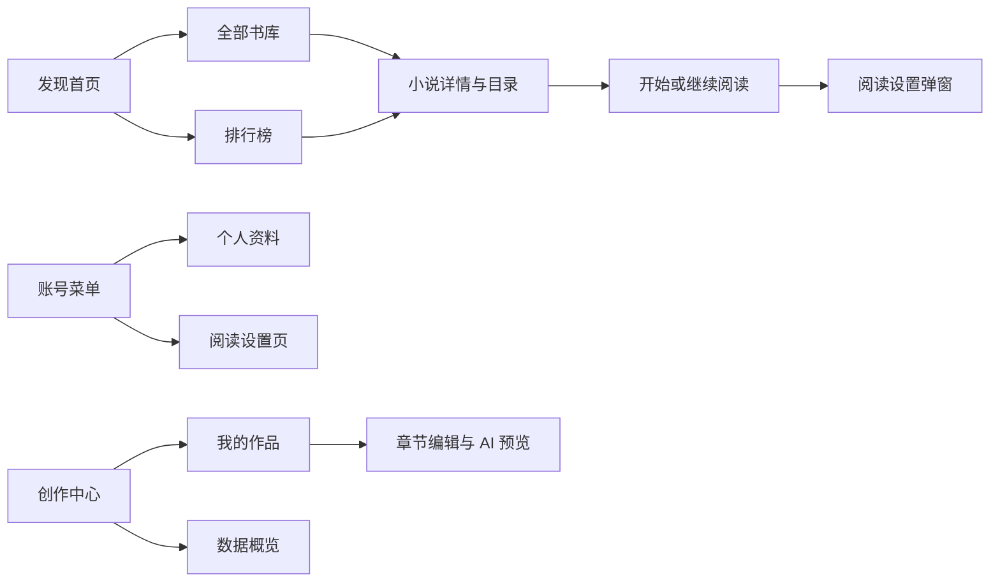

# v0.12 界面与交互设计

本轮根据实际页面操作重新整理找书、阅读、写作和管理流程。前端为 0.12.0，兼容当前 0.10.0 后端；保留全部 13 个功能模块，没有新增运行依赖、数据库表或接口。验证方式见 [验证记录](验证记录_v0.12.md)。

## 1. 从任务安排页面

| 原有问题 | 调整后的操作 |
| --- | --- |
| 首页宣传区占据首屏，找书需要向下滚动 | 首页直接搜索、选题材、看榜单；完整筛选进入独立书库 |
| 顶栏混杂阅读、资料和角色操作 | 阅读导航常驻，创作/管理入口独立，资料、阅读设置和退出集中在账号菜单 |
| 作者先看到大段数据，再找到自己的作品 | 创作中心默认展示作品，数据概览单独切换 |
| AI 面板与正文纵向堆叠，保存操作容易滚出屏幕 | 宽屏正文和 AI 并排；保存、送审放在吸顶工具栏，专注模式隐藏 AI 面板 |
| 阅读设置分散 | 独立设置页与正文弹窗共用同一份偏好，修改即时保存 |
| 目录翻页改变阅读起点，还会清空评论输入 | 开始阅读固定首章，有进度优先继续阅读；同一作品翻目录保留未发表评论 |
| 输入了新筛选却未查询，翻页悄悄换条件 | 书库、排行榜和用户管理区分输入与已查询条件；翻页使用已查询条件，并恢复表单显示 |

## 2. 页面与导航

| 路径 | 用途 |
| --- | --- |
| `/` | 发现首页，关键词搜索直达书库，展示题材和近期作品 |
| `/library` | 全部书库，组合查询、页码、刷新与返回恢复 |
| `/rankings` | 四类榜单，可筛选题材和状态 |
| `/settings` | 阅读偏好与实时预览，游客也可使用 |
| `/bookshelf` | 本人书架和阅读进度，仍需登录 |
| `/author` | 本人作品列表 |
| `/author?view=stats` | 本人作品数据概览 |
| `/author/chapters/:id` | 章节编辑，正文和 AI 面板并列 |
| `/admin` 及已有子路由 | 审核、评论、用户、分类标签、管理记录 |

旧首页 `#library` 或带书库条件的收藏链接会跳转到 `/library`，保留查询参数。详情的“返回书库”进入默认书库；恢复来源查询使用浏览器返回。登录仍优先回到来源页，无来源时按角色进入原有入口。前端路由守卫与后端角色、数据归属检查继续生效。

账号按钮使用展开状态提示，支持外部点击和 Escape 关闭；Escape 后焦点回到按钮。主内容保留跳转链接。作者与管理员的侧栏采用明确的当前选中样式，不使用无业务意义的编号。

## 3. 阅读设置和编辑保护

阅读偏好包括纸色/护眼/夜间、16—28px 字号、四档行距和三档版心宽度。`readingSettings.js` 负责默认值和输入校验，`useReadingPreferences.js` 负责共享状态与浏览器保存；`ReadingPreferences.vue` 同时供设置页和正文弹窗使用。

设置沿用 `mojian_reading_settings` 存储键，兼容旧字号和背景。非法值、损坏 JSON、无法访问存储时回到默认值；无法写入时提示本次有效但未保存。偏好保存在当前浏览器，不随账号同步；账号阅读进度仍由原有接口保存在数据库。

正文弹窗使用原生 dialog 的焦点约束、Escape 和关闭后焦点恢复。夜间主题作用于阅读区域；设置控件保持清楚的文字与边界。宽屏编辑页保留正文、AI 两栏，小屏自然堆叠；删除与导出收在“更多操作”。原保存、版本冲突、本地草稿恢复、审核和 AI 预览采用逻辑不改变。生成仍由用户主动触发，本轮没有追加真实 AI 请求。

## 4. 样式与组件职责

界面采用系统中文无衬线字体、雾灰底色、白色内容区和松绿强调色。书名、阅读正文适当保留宋体。统一控件尺寸、边框、标题、间距和可见键盘焦点；不新增字体下载或大幅装饰图片。

| 文件 | 职责 |
| --- | --- |
| [App.vue](../frontend/src/App.vue) | 公共导航、角色入口和布局选择 |
| [HeaderAccount.vue](../frontend/src/components/HeaderAccount.vue) | 账号菜单展开、关闭与焦点恢复 |
| [AuthorLayout.vue](../frontend/src/components/AuthorLayout.vue)、[AdminLayout.vue](../frontend/src/components/AdminLayout.vue) | 工作区侧栏和当前功能定位 |
| [LibraryPage.vue](../frontend/src/views/LibraryPage.vue) | 查询表单、网址协调和书库展示 |
| [ReadingPreferences.vue](../frontend/src/components/ReadingPreferences.vue) | 可复用阅读偏好表单 |
| [ReadingSettingsDialog.vue](../frontend/src/components/ReadingSettingsDialog.vue) | 正文设置弹窗 |
| [style.css](../frontend/src/style.css) | 基础样式、颜色与公共控件 |
| [content.css](../frontend/src/content.css) | 业务内容和已有组件样式 |
| [experience.css](../frontend/src/experience.css) | 导航、工作区、阅读与写作布局及响应式规则 |

组件继续使用 Vue Composition API 与现有 JavaScript。业务请求、查询参数、阅读偏好分别维护，避免将全部交互放进页面模板。

## 5. 参考技能来源

本轮安装并使用两个公开技能作为设计与检查方法，未将技能包当作业务代码复制入工程：

- [Anthropic frontend-design](https://github.com/anthropics/skills/tree/dbd4588f9e1033efb41dad4bef2f7947c8993d44/skills/frontend-design)，固定提交 `dbd4588f9e1033efb41dad4bef2f7947c8993d44`，随包 LICENSE.txt 为 Apache-2.0。
- [Vercel web-design-guidelines](https://github.com/vercel-labs/agent-skills/tree/1a2c79d4e6c4a2283dc2c614b6538cbe1ed5ca62/skills/web-design-guidelines)，固定提交 `1a2c79d4e6c4a2283dc2c614b6538cbe1ed5ca62`；审查规则取自 [Web Interface Guidelines](https://github.com/vercel-labs/web-interface-guidelines/blob/434b7f91364665f2f733b310ec54809bf8f37937/command.md) 固定版本。

安装前检查文件，安装后对三个文本文件逐一比对 SHA-256，一致。原 Vue 组件和路由实践技能继续使用。技能用于帮助规划与走查，不能代替真实浏览器验证或用户试用。
