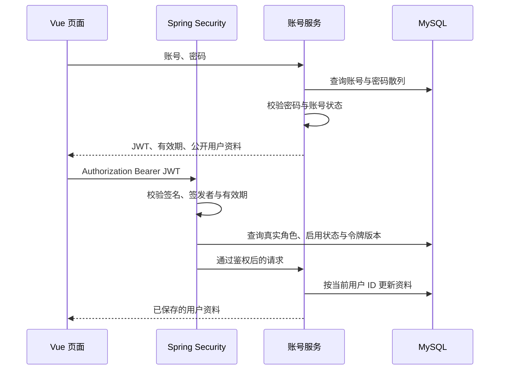

# 账号模块设计与接口（v0.1）

本轮实现 FR-01，并建立作者、管理员的身份验证入口。其他 12 个业务模块仍在范围中，尚未实现。“墨间”为暂定界面展示名。业务源码按需求独立编写，没有复制实验项目业务代码。

## 核心流程

前端菜单用于操作引导，实际权限由后端判断。资料接口目标来自已验证令牌，不接受客户端指定用户 ID。独立 DTO 拒绝额外字段，数据库实体不直接返回前端。

密码采用 Spring Security PBKDF2 的 v5.8 参数（随机盐、310000 次迭代），只保存散列。JWT 采用 HS256，有效期 2 小时，至少 32 字节的随机签名密钥由环境配置注入。每次鉴权读取数据库的真实角色、状态和令牌版本。

退出登录原子增加 `token_version`，使该账号此前签发的所有令牌失效，即当前版本的“退出所有会话”。停用账号也会阻止旧令牌。前端令牌仅保存于当前标签页 sessionStorage，退出清除；不写 URL 或日志。昵称和简介按文本渲染，不执行 HTML。

仅使用 Authorization Bearer，不采用 Cookie 自动携带身份，因此关闭 CSRF 过滤；开发请求走 Vite 同源代理，不开放跨站 CORS。公开部署需使用 HTTPS 与同源反向代理。

## 角色边界

| 能力 | 游客 | 读者 | 作者 | 管理员 |
| --- | --- | --- | --- | --- |
| 注册、登录、健康检查 | 允许 | 允许 | 允许 | 允许 |
| 本人资料、退出 | 拒绝 | 允许 | 允许 | 允许 |
| 作者身份入口 | 拒绝 | 拒绝 | 允许 | 拒绝 |
| 管理员身份入口 | 拒绝 | 拒绝 | 拒绝 | 允许 |

管理员不自动获得作者权限。作品等资源的归属校验将在对应功能实现时补充，本轮账号测试不能代替它们的测试。

## 接口清单

成功返回业务 JSON，退出返回 204。错误格式为 `{"code":"错误码","message":"中文提示"}`；400 输入不合法、401 登录失败或失效、403 无权限、409 账号重复、500 服务错误。

| 方法与路径 | 输入 | 成功结果 |
| --- | --- | --- |
| GET `/api/health` | 无 | status=UP，仅表示进程响应 |
| POST `/api/auth/register` | username、password、nickname、role | 201，用户公开资料 |
| POST `/api/auth/login` | username、password | accessToken、expiresAt、user |
| GET `/api/users/me` | Bearer 令牌 | 当前用户公开资料 |
| PUT `/api/users/me` | Bearer 令牌，nickname、bio | 更新后的本人资料 |
| POST `/api/auth/logout` | Bearer 令牌 | 204，旧令牌失效 |
| GET `/api/author/workspace` | 作者令牌 | 身份通过提示 |
| GET `/api/admin/workspace` | 管理员令牌 | 身份通过提示 |

注册账号限定 4—20 位 ASCII 字母、数字或下划线，统一转小写；密码 8—64 位且不能全为空白；昵称非空、最多 30 字；简介最多 500 字。注册仅允许 READER/AUTHOR。资料响应为 id、username、nickname、bio、role，不含密码散列或内部配置。PUT 仅接受 nickname、bio；提交 id、role、enabled 等额外字段返回 400。

管理员由环境变量 ADMIN_USERNAME/ADMIN_PASSWORD 初始化，两项都空则不创建。仅不存在时创建；已有管理员不重置密码，同名普通账号使启动失败，不自动提权。本地脚本生成随机密码，只保存到被忽略的 `.runtime/settings.local.json`。

## 登录导航（v0.3 补充）

登录页不再默认跳转个人中心，按以下优先级决定去向：

1. 有有效的来源页面时，回到该页面，包括作品详情、阅读页及其 `resume=1` 参数、书架、个人中心和当前身份有权使用的编辑页。
2. 无来源或来源无效时，读者进入首页、作者进入作者工作台、管理员进入审核后台。
3. 登录与注册互相切换、注册成功转回登录时，保留同一个来源。注册后仍需本人登录，不自动登录。
4. 已登录用户访问登录或注册页直接跳到上述目标；登录成功使用 replace，减少返回键再次进入表单的情况。

首页顶部登录使用身份默认入口；书籍详情和阅读页顶部登录保留当前页面。个人中心保留在导航中，作为主动查看与维护资料的入口。

`navigation.js` 集中校验来源，只接受已知站内路由。外部地址、未知路由、登录注册页和异常查询参数不作为回跳目标；作者与管理员页面同时检查真实登录角色。该检查用于页面导航，不能替代服务端鉴权和数据归属校验。收藏触发登录后回到原书页，由用户再次确认收藏，不自动执行写入。

## 当前限制

尚未实现密码修改、找回密码、刷新令牌、登录限流和审计界面；当前仅供本机开发演示，不直接作为公网服务。后续按作品、章节、审核的流程增加数据库迁移和权限测试。

技术依据：[Spring Boot 3.5 系统要求](https://docs.spring.io/spring-boot/3.5/system-requirements.html)、[MyBatis-Plus 安装说明](https://baomidou.com/getting-started/install/)。依赖实际版本以 pom.xml 与 package-lock.json 为准。
